# Sơ đồ điều hướng

## Cấu trúc

- **Ngoài phiên đăng nhập:** Đăng nhập (1); Quên mật khẩu 12a → 12b → 12c → 12d; Đăng ký 13a → 13b. Màn Đăng nhập không có nút quét QR (ADR-004).
- **Cấp tài khoản** — thanh thẻ nổi **Dự án (2)** · **Tôi (3)**. Màn con: Thêm dự án 14a → 14b → 14c, 14a → Quét QR (18); Thông tin tài khoản (15).
- **Cấp dự án** — thanh thẻ nổi **Màn hình chính (4)** · **Thiết bị (5)** · **Dịch vụ (6)**; cả ba có nút ← ở đầu trang về **Dự án (2)** (ADR-003). Màn con: Cảnh báo (10) → 10a → Yêu cầu hỗ trợ (8); Nguồn năng lượng pin (11); Cấu hình dự án (16) → 16a → 16b; Theo dõi dữ liệu (17); Khám phá (7); Hỗ trợ (8) → Chi tiết yêu cầu (8); Bảo hành (9).
- Màn con có nút quay lại về đúng bước trước. Mở màn 8 từ 10a thì quay lại về 10a.

## Sơ đồ

```mermaid
flowchart LR
  Login["1 · Đăng nhập"]
  ForgotPassword["12a · Quên mật khẩu – Tìm tài khoản"]
  ForgotPasswordOtp["12b · Quên mật khẩu – Mã xác thực"]
  ForgotPasswordNew["12c · Quên mật khẩu – Mật khẩu mới"]
  ForgotPasswordDone["12d · Quên mật khẩu – Thành công"]
  Register["13a · Đăng ký – Thông tin"]
  RegisterOtp["13b · Đăng ký – Xác thực OTP"]
  QRScan["18 · Thêm thiết bị bằng QR"]
  ProjectsEmpty["2 · Dự án (chưa có dự án)"]
  Projects["2 · Dự án"]
  AddProject["14a · Thêm dự án – Thiết bị"]
  AddProjectInfo["14b · Thêm dự án – Thông tin dự án"]
  AddProjectTariff["14c · Thêm dự án – Giá điện"]
  Me["3 · Tôi"]
  Account["15 · Thông tin tài khoản"]
  Main["4 · Màn hình chính"]
  Config["16 · Cấu hình dự án"]
  TouSchedule["16a · Lịch theo khung giờ – Danh sách chiến lược"]
  TouStrategy["16b · Chi tiết chiến lược"]
  Alerts["10 · Cảnh báo"]
  AlertDetail["10a · Chi tiết cảnh báo"]
  BatteryEnergy["11 · Nguồn năng lượng pin"]
  Device["5 · Thiết bị"]
  DataInverter["17 · Theo dõi dữ liệu – Inverter"]
  DataBattery["17 · Theo dõi dữ liệu – Pin S16 Pre"]
  Service["6 · Dịch vụ"]
  Explore["7 · Khám phá"]
  Support["8 · Yêu cầu hỗ trợ"]
  TicketDetail["8 · Chi tiết yêu cầu"]
  Warranty["9 · Bảo hành"]
  Login --> ForgotPassword
  Login --> Projects
  Login --> Register
  ForgotPassword --> Login
  ForgotPassword --> ForgotPasswordOtp
  ForgotPasswordOtp --> ForgotPassword
  ForgotPasswordOtp --> ForgotPasswordNew
  ForgotPasswordNew --> ForgotPasswordOtp
  ForgotPasswordNew --> ForgotPasswordDone
  ForgotPasswordDone --> Login
  Register --> Login
  Register --> RegisterOtp
  RegisterOtp --> Register
  RegisterOtp --> ProjectsEmpty
  QRScan --> AddProject
  ProjectsEmpty --> AddProject
  ProjectsEmpty --> Projects
  ProjectsEmpty --> Me
  Projects --> AddProject
  Projects --> Main
  Projects --> Me
  AddProject --> Projects
  AddProject --> QRScan
  AddProject --> AddProjectInfo
  AddProjectInfo --> AddProject
  AddProjectInfo --> AddProjectTariff
  AddProjectTariff --> AddProjectInfo
  AddProjectTariff --> Main
  Me --> Account
  Me --> Login
  Me --> Projects
  Account --> Me
  Main --> Projects
  Main --> Alerts
  Main --> Config
  Main --> BatteryEnergy
  Main --> Device
  Main --> Service
  Config --> Main
  Config --> TouSchedule
  TouSchedule --> Config
  TouSchedule --> TouStrategy
  TouStrategy --> TouSchedule
  Alerts --> Main
  Alerts --> AlertDetail
  AlertDetail --> Alerts
  AlertDetail --> Support
  BatteryEnergy --> Main
  Device --> Projects
  Device --> DataInverter
  Device --> DataBattery
  Device --> Main
  Device --> Service
  DataInverter --> Device
  DataBattery --> Device
  Service --> Projects
  Service --> Explore
  Service --> Support
  Service --> Warranty
  Service --> Main
  Service --> Device
  Explore --> Service
  Support --> Service
  Support --> TicketDetail
  TicketDetail --> Support
  Warranty --> Service
  Warranty --> Support
```

## Bảng liên kết (lấy tự động từ thiết kế)

| Từ | Tới | Phần tử bấm |
|---|---|---|
| 1 · Đăng nhập | 12a · Quên mật khẩu – Tìm tài khoản | Quên mật khẩu? |
| 1 · Đăng nhập | 2 · Dự án | Đăng nhập |
| 1 · Đăng nhập | 13a · Đăng ký – Thông tin | Đăng ký |
| 12a · Quên mật khẩu – Tìm tài khoản | 1 · Đăng nhập | Quay lại |
| 12a · Quên mật khẩu – Tìm tài khoản | 12b · Quên mật khẩu – Mã xác thực | Gửi mã xác thực |
| 12b · Quên mật khẩu – Mã xác thực | 12a · Quên mật khẩu – Tìm tài khoản | Quay lại |
| 12b · Quên mật khẩu – Mã xác thực | 12c · Quên mật khẩu – Mật khẩu mới | Xác nhận |
| 12c · Quên mật khẩu – Mật khẩu mới | 12b · Quên mật khẩu – Mã xác thực | Quay lại |
| 12c · Quên mật khẩu – Mật khẩu mới | 12d · Quên mật khẩu – Thành công | Đổi mật khẩu |
| 12d · Quên mật khẩu – Thành công | 1 · Đăng nhập | Quay lại |
| 13a · Đăng ký – Thông tin | 1 · Đăng nhập | Quay lại |
| 13a · Đăng ký – Thông tin | 13b · Đăng ký – Xác thực OTP | Tạo tài khoản |
| 13b · Đăng ký – Xác thực OTP | 13a · Đăng ký – Thông tin | Quay lại |
| 13b · Đăng ký – Xác thực OTP | 2 · Dự án (chưa có dự án) | Xác thực |
| 18 · Thêm thiết bị bằng QR | 14a · Thêm dự án – Thiết bị | Đóng |
| 2 · Dự án (chưa có dự án) | 14a · Thêm dự án – Thiết bị | Thêm dự án |
| 2 · Dự án (chưa có dự án) | 2 · Dự án | Dự án |
| 2 · Dự án (chưa có dự án) | 3 · Tôi | Tôi |
| 2 · Dự án | 14a · Thêm dự án – Thiết bị | Thêm dự án |
| 2 · Dự án | 4 · Màn hình chính | Nhà của bạn Văn Giang, Hưng Yên Inverter hybrid 5 kW · S16 P |
| 2 · Dự án | 3 · Tôi | Tôi |
| 14a · Thêm dự án – Thiết bị | 2 · Dự án | Quay lại |
| 14a · Thêm dự án – Thiết bị | 18 · Thêm thiết bị bằng QR | Quét mã QR |
| 14a · Thêm dự án – Thiết bị | 14b · Thêm dự án – Thông tin dự án | Tiếp tục |
| 14b · Thêm dự án – Thông tin dự án | 14a · Thêm dự án – Thiết bị | Quay lại |
| 14b · Thêm dự án – Thông tin dự án | 14c · Thêm dự án – Giá điện | Tiếp tục |
| 14c · Thêm dự án – Giá điện | 14b · Thêm dự án – Thông tin dự án | Quay lại |
| 14c · Thêm dự án – Giá điện | 4 · Màn hình chính | Bỏ qua |
| 3 · Tôi | 15 · Thông tin tài khoản | Thông tin tài khoản |
| 3 · Tôi | 1 · Đăng nhập | Đăng xuất |
| 3 · Tôi | 2 · Dự án | Dự án |
| 15 · Thông tin tài khoản | 3 · Tôi | Quay lại |
| 4 · Màn hình chính | 2 · Dự án | Quay lại Dự án (ADR-003) |
| 4 · Màn hình chính | 10 · Cảnh báo | Cảnh báo, 2 chưa xử lý |
| 4 · Màn hình chính | 16 · Cấu hình dự án | Chế độ hoạt động: Tự tiêu thụ tối đa. Mở cấu hình dự án |
| 4 · Màn hình chính | 11 · Nguồn năng lượng pin | Xem nguồn năng lượng trong pin S16 Pre |
| 4 · Màn hình chính | 5 · Thiết bị | Thiết bị |
| 4 · Màn hình chính | 6 · Dịch vụ | Dịch vụ |
| 16 · Cấu hình dự án | 4 · Màn hình chính | Quay lại |
| 16 · Cấu hình dự án | 16a · Lịch theo khung giờ – Danh sách chiến lược | Khung giờ sạc/xả: mở danh sách chiến lược |
| 16a · Lịch theo khung giờ – Danh sách chiến lược | 16 · Cấu hình dự án | Quay lại Cấu hình dự án |
| 16a · Lịch theo khung giờ – Danh sách chiến lược | 16b · Chi tiết chiến lược | Thẻ chiến lược / Thêm chiến lược |
| 16b · Chi tiết chiến lược | 16a · Lịch theo khung giờ – Danh sách chiến lược | Quay lại danh sách chiến lược |
| 10 · Cảnh báo | 4 · Màn hình chính | Quay lại |
| 10 · Cảnh báo | 10a · Chi tiết cảnh báo | Chạm một cảnh báo |
| 10a · Chi tiết cảnh báo | 10 · Cảnh báo | Quay lại Cảnh báo |
| 10a · Chi tiết cảnh báo | 8 · Yêu cầu hỗ trợ | Tạo yêu cầu hỗ trợ kỹ thuật |
| 11 · Nguồn năng lượng pin | 4 · Màn hình chính | Quay lại |
| 5 · Thiết bị | 17 · Theo dõi dữ liệu – Inverter | Inverter hybrid 5 kW SN [SỐ SERIAL] Online Công suất 4,2 kW  |
| 5 · Thiết bị | 17 · Theo dõi dữ liệu – Pin S16 Pre | Pin S16 Pre Đang sạc · đầy sau ~2 giờ SoC 76 % Công suất 1,1 |
| 5 · Thiết bị | 2 · Dự án | Quay lại Dự án (ADR-003) |
| 5 · Thiết bị | 4 · Màn hình chính | Màn hình chính |
| 5 · Thiết bị | 6 · Dịch vụ | Dịch vụ |
| 17 · Theo dõi dữ liệu – Inverter | 5 · Thiết bị | Quay lại |
| 17 · Theo dõi dữ liệu – Pin S16 Pre | 5 · Thiết bị | Quay lại |
| 6 · Dịch vụ | 7 · Khám phá | Khám phá Sản phẩm, tin tức và video hướng dẫn |
| 6 · Dịch vụ | 8 · Yêu cầu hỗ trợ | Hỗ trợ Gửi yêu cầu kỹ thuật, tài khoản |
| 6 · Dịch vụ | 9 · Bảo hành | Bảo hành Ngày kích hoạt, hạn và tình trạng bảo hành |
| 6 · Dịch vụ | 2 · Dự án | Quay lại Dự án (ADR-003) |
| 6 · Dịch vụ | 4 · Màn hình chính | Màn hình chính |
| 6 · Dịch vụ | 5 · Thiết bị | Thiết bị |
| 7 · Khám phá | 6 · Dịch vụ | Quay lại |
| 8 · Yêu cầu hỗ trợ | 6 · Dịch vụ | Quay lại |
| 8 · Yêu cầu hỗ trợ | 8 · Chi tiết yêu cầu | Chạm một phiếu |
| 8 · Chi tiết yêu cầu | 8 · Yêu cầu hỗ trợ | Quay lại |
| 9 · Bảo hành | 6 · Dịch vụ | Quay lại |
| 9 · Bảo hành | 8 · Yêu cầu hỗ trợ | Yêu cầu bảo hành |
